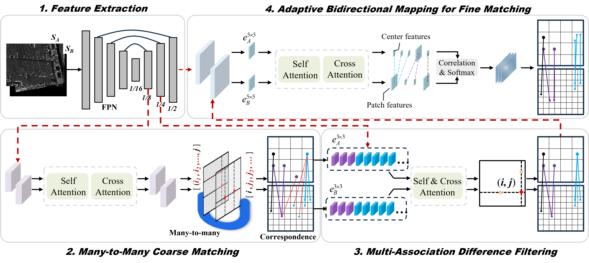

## LAMM: Large-scale invariant multi-source remote sensing image matching based on Adaptive Many-to-many Mapping.
This is a code demo for the paper: [LAMM: Large-scale invariant multi-source remote sensing image matching based on Adaptive Many-to-many Mapping.](https://www.sciencedirect.com/science/article/pii/S0924271626004016)


<div align=center></div>


## References
If you find this code helpful, please kindly cite:
```
@article{liu2026lamm,
  title={LAMM: Large-scale invariant multi-source remote sensing image matching based on Adaptive Many-to-many Mapping},
  author={Liu, Yuyan and He, Wei and Zhang, Hongyan},
  journal={ISPRS Journal of Photogrammetry and Remote Sensing},
  volume={242},
  pages={74--89},
  year={2026},
  publisher={Elsevier}
}
```

Some of our reference projects are listed below, and we are very grateful for their research:
* [LoFTR: Detector-Free Local Feature Matching with Transformers.](https://github.com/zju3dv/LoFTR)
* [XoFTR: Cross-modal Feature Matching Transformer.](https://github.com/OnderT/XoFTR)


## Dataset
* You can download the SUIRD datasets at: https://github.com/yyangynu/SUIRD.
* You can download the MRSID datasets at: https://github.com/LJY-RS/RIFT-multimodal-image-matching.
* You can download the hyperspectral datasets at: https://github.com/YingJiacheng/UHIF-RIM.


## Run LAMM demo
1. download the models at here: https://pan.baidu.com/s/1bqAzsPndCUDDBtz3YTlTXg?pwd=yhkd 
code: yhkd
2. run demo.py
